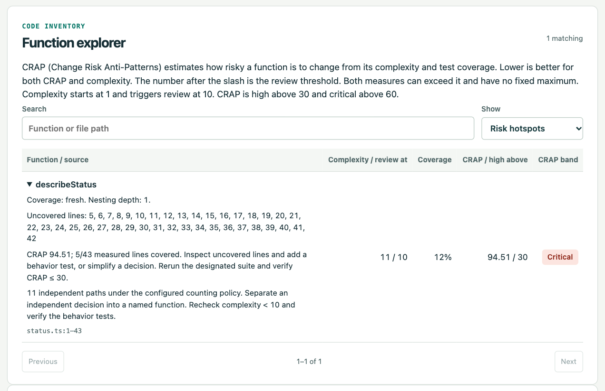
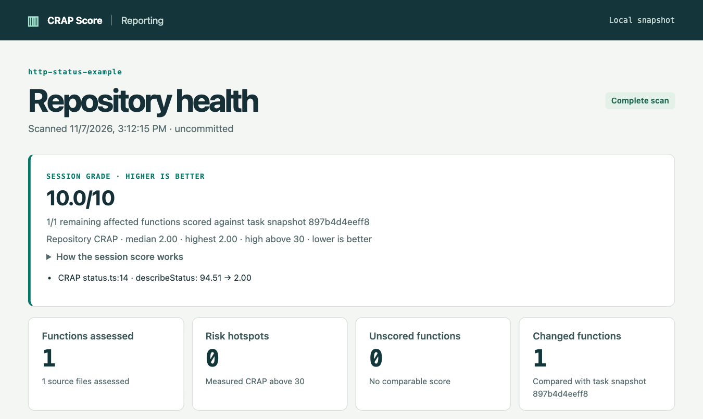
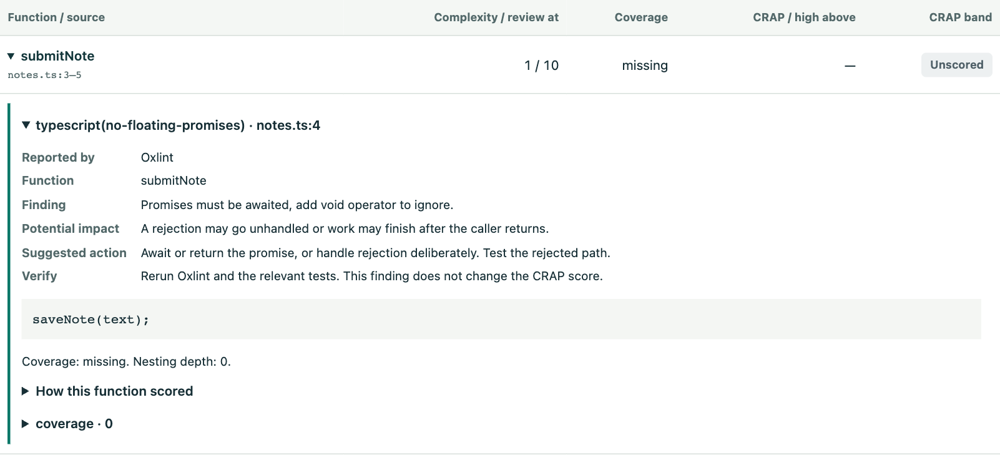

# CRAP Score MCP

Use **agent skills** to review a Git checkout for **code quality, OWASP-mapped application security, WCAG and Section 508 accessibility, and color vision**. The skills run a local MCP server and bring the results back into your coding session, with source lines, scorecards and detailed finding reports.

**[Open the documentation](https://paulboutin.github.io/crap-mcp/)** · [Install and connect](https://paulboutin.github.io/crap-mcp/getting-started/)

## Choose an agent skill

After installation, open your project in your coding agent and give it one of these prompts.

| What you want to do | Try in Codex | Guide |
| --- | --- | --- |
| Review a patch for change risk | `Use $crap-development-review to review my patch.` | [Development review](https://paulboutin.github.io/crap-mcp/skills/development-review/) |
| Inspect application security | `Use $crap-security-review to assess this checkout.` | [Security review](https://paulboutin.github.io/crap-mcp/skills/security-review/) |
| Check accessibility, contrast and color vision | `Use $crap-accessibility-review to check this UI.` | [Accessibility review](https://paulboutin.github.io/crap-mcp/skills/accessibility-review/) |
| Pick a maintenance task | `Use $crap-backlog-triage to pick one cleanup.` | [Backlog triage](https://paulboutin.github.io/crap-mcp/skills/backlog-triage/) |

In Claude Code, invoke the same skill with a slash, such as `/crap-security-review`. In OpenCode, ask “Use the crap-security-review skill on this checkout.”

## The five scores

| Score | How to read it | Where to start |
| --- | --- | --- |
| Function CRAP | Lower is better. A value of 94.51 against a threshold of 30 calls for review. | [Function CRAP guide](https://paulboutin.github.io/crap-mcp/scores/function-crap/) |
| Session health | Higher is better, up to 10. Each changed function contributes complexity, nesting, CRAP and coverage evidence. | [Session health guide](https://paulboutin.github.io/crap-mcp/scores/session-health/) |
| Application security | Higher is better, up to 100. Each enabled OWASP-mapped source match carries a penalty. | [Security score guide](https://paulboutin.github.io/crap-mcp/scores/security/) |
| Accessibility | Higher is better, up to 100. The report counts known passes and failures and lists pending checks. | [Accessibility score guide](https://paulboutin.github.io/crap-mcp/scores/accessibility/) |
| Colorblind | Higher is better, up to 100. Each measured pair must meet its contrast target in all three color vision simulations to earn a pass. | [Colorblind score guide](https://paulboutin.github.io/crap-mcp/scores/colorblind/) |

Original code and documentation are available under the [MIT license](LICENSE). See the [contributing guide](CONTRIBUTING.md) for local setup and pull requests, and [third-party notices](THIRD_PARTY_NOTICES.md) for vendored components and language packs.

## See a hotspot before and after cleanup

These screenshots follow `describeStatus` in the repo’s [HTTP-status example](test/fixtures/http-status/). Initially the function chooses between ten HTTP status codes, but the only test calls it with `200`. Open the finding to see which lines the test missed.



| What changed | Complexity | Measured lines covered | Raw CRAP ↓ |
| --- | ---: | ---: | ---: |
| Baseline: one status tested | 11 | 5/43 | 94.51 |
| Test every supported status and the fallback; keep the function unchanged | 11 | 43/43 | 11.00 |
| Replace the branches with a table lookup; rerun the same assertions | 2 | 3/3 | 2.00 |

The extra tests closed the coverage gap. The refactor then reduced the number of paths through the function. The session report shows both the final **10/10** grade and the function’s **94.51 → 2.00** raw CRAP change.



Run `npm ci` and `npm run prove` to [reproduce the measurements](#reproduce-the-end-to-end-proof).

## Inspect a recommendation for one function

In **Function explorer**, select **Functions with code patterns**, expand a function, then open its rule. In this fictional example, `submitNote` calls `saveNote(text)` and returns before the save finishes. Oxlint identifies the unhandled promise even without test coverage.



The [finding walkthrough](docs/findings.md#inspect-a-function-recommendation) shows how to test the rejected save.

## Try it on this repository

Requires Git and Node.js 24.12+ (CI runs Node 24). From the clone root:

```sh
git clone https://github.com/paulboutin/crap-mcp.git
cd crap-mcp
npm ci
npm run check
```

The last step runs Oxlint, builds the server, records coverage from passing tests, then launches the compiled server as a child process. An MCP client lists its tools, inspects the scoring function, pages through the backlog, and reviews the diff. Set `CRAP_BASE` to a starting revision to review a longer change. CI uses the push or PR base. The gate rejects skipped source, stale/missing evidence and all CRAP, complexity and nesting hotspots. Single-line callbacks can remain unscored when line counts cannot isolate their execution.

## Install once for all your projects (macOS)

From one copy of this repository, run `npm run install:machine`. You need Node.js 24.12+, npm, Git, and Python 3. The installer detects Codex, Claude Code and OpenCode on PATH. The installer builds a private runtime under `~/.local/share/crap-mcp`, starts one per-user launchd service at login, connects detected clients to the same HTTP endpoint, and links the CRAP, security and accessibility skills in the user skill directories. Rerun the installer from an updated checkout to upgrade. Target projects need no copy of this server, dependencies or Codex config. If a project has an old project-local `crap_score` stdio override, remove that override to use the machine connection.

Use the same skills in each harness. In Claude Code run `/crap-development-review` or `/crap-backlog-triage`. In OpenCode ask “Use the crap-development-review skill on this checkout.” In Codex use `$crap-development-review`. The installer links one canonical copy into `~/.agents/skills` and Claude Code’s `~/.claude/skills` (or `CLAUDE_CONFIG_DIR/skills`). OpenCode also discovers the shared agents directory. If you install another client later, run `bash ~/.local/share/crap-mcp/current/scripts/connect-clients.sh`. For a foreground service, point each client's HTTP MCP entry at its `/mcp` endpoint and install the skill folders in that client’s supported skill directory.

At the end of a development review, the skill requests `review_changes` with `format:"markdown"` and displays the returned card in its reply. It includes the session score, coverage evidence, QA and benchmark results for the matching check, and a link to the standalone report.

Open a new Codex chat in a trusted Git checkout and ask **“Use $crap-development-review on this change”** or **“Use $crap-backlog-triage in this project.”** The skill calls `register_project` with the checkout path. Registration returns a stable ID for that path. Every subsequent analysis call supplies that ID, so concurrent chats and linked worktrees keep separate targets. The picker at [the local dashboard](http://127.0.0.1:47731/) lists the registered checkout paths and opens the most recent report generated with `npm run dashboard` for that checkout. **View live checkout** shows the current source and designated suite. Projects without a recorded report open the live view. Reload to discover newly registered projects. For a task comparison, open `/?project=<id>&snapshot=<starting-snapshot>`.

Structural findings work immediately for TypeScript, TSX and Swift. For numeric CRAP scores, configure each project's coverage command and record its passing suite (below). The installed recorder is at `~/.local/share/crap-mcp/current/dist/record.js`. Registering a project writes its path to the local catalog and saves analysis under its Git directory. The machine service listens only on loopback and is intended for a trusted single-user workstation. Local processes can access registered reports and register checkouts. The browser cannot register a project through the picker.

For other platforms or development, run `npm ci && npm run machine` in one server checkout, then run `codex mcp add crap_score --url http://127.0.0.1:47731/mcp` and install the skill folders in your user skills directory. The foreground service uses the same catalog and API. `CRAP_PORT` and `CRAP_DATA_DIR` override the foreground defaults.

## Project settings, checks and agent feedback

Select the checkout in the dashboard, then open **Project settings**. Settings and check history start local to each checkout. A checked-in team manifest supplies shared settings and lessons. Adjust the maximum raw CRAP per function, minimum measured line coverage per function, and the enabled Oxlint and native lint rules/tools. Save to apply them to the next check. The settings page records newly enabled and removed rules, language packs and target changes. A stale browser tab must reload before saving. The standard dashboard risk bands and session grading rubric still use the documented cross-project thresholds.

For checkout-specific directory omissions, enter one literal path per line under **Directory omissions**, such as `src/generated/` or `fixtures/legacy/`. The MCP skips those subtrees in scans, coverage imports and bundled Oxlint checks. The checked-in `.crap.json` field `exclude` supplies additional shared source-analysis prefixes. Native linters and arbitrary test commands use their own ignore settings. Start a new baseline and record fresh coverage after changing scope.

For a rule unique to your project, enable a catalog rule in settings or add a custom rule to the project's linter configuration and run that linter through `.crap.json`'s `checks` array. The project check history records the command's exit status.

The development-review and backlog-triage skills probe the service before use and start the installed launch agent when it is offline. They register the current checkout, read its recent results, enable any required optional parser, then capture a baseline. Development review records each attempted change and reruns the checks. Backlog triage records the starting evidence and uses earlier outcomes when choosing a task. Example: **“Use $crap-development-review, enable Python for this project, and check my change.”**

From the target checkout, run the same workflow manually:

```sh
bash ~/.local/share/crap-mcp/current/scripts/ensure-service.sh
node ~/.local/share/crap-mcp/current/dist/project-check.js "Covered the empty-input branch"
```

The checker runs the bundled Oxlint rules on JS/TS, any opted-in native linters and the project's extra checks, then wraps the designated test command with the coverage recorder. Set `report` in `.crap.json` when the report path differs from `coverage/lcov.info`. The optional `checks` field accepts argument arrays, e.g. `"checks": [["npm", "run", "typecheck"]]`. These commands run from the target checkout when the agent or developer invokes the CLI. For a foreground installation, use `node /path/to/crap-mcp/dist/project-check.js "attempt"`. Standard Oxlint correctness defaults also apply. Native linters use their own project configuration.

Each attempt logs its note, time, commit, suite, policy ID, available lint counts by rule, native command exit status, coverage receipt, measured lines/functions, highest CRAP and target violations. Failed tests log a failed attempt without borrowing an earlier score. Missing coverage or a partial scan yields incomplete evidence. The checker exits nonzero for failed or incomplete runs. The dashboard and `get_project_settings` show the latest 30 attempts. Compare runs with the same suite and policy and use the function diff for attribution. This is local, retrievable feedback for the next agent session. Rules change through explicit settings edits.

## Compare behavior and performance after a cleanup

Ask **“Use $crap-development-review to baseline this cleanup, replay the acceptance checks, compare performance, and log what we learned.”** In `.crap.json`, configure named workloads with a version and an argument array. For example:

```json
"experiments": [
  {"kind":"qa","name":"Replay saved match","version":"1","command":["node","qa/replay.mjs"]},
  {"kind":"benchmark","name":"Replay 600 frames","version":"1","command":["node","qa/frame-time.mjs"],"maxMs":40}
]
```

The QA command should check expected output (for example, each frame’s state hash) and exit nonzero on divergence. A benchmark prints one finite nonnegative JSON number in milliseconds for a fixed workload. The checker runs it five times, retains every sample, and compares medians. An optional `maxMs` budget, a bad measurement, or a failed scenario fails the check. The two-minute timeout applies per invocation. A lower CRAP score measures complexity and test coverage. Correctness and speed require their own evidence.

Run the project checker before and after the change. Increment the workload version when the scenario, fixture, benchmark implementation or measurement conditions change. Matching requires the same definition, machine and Node version. Timing differences need reproduction under comparable load. The report shows the latest two attempts and labels missing or incompatible evidence. The agent can use `record_project_learning` to preserve a specific pair, explain a finding, and propose a follow-up. Applied policy changes and their reasons appear separately in the standard report. A proposal becomes enforceable when a rule is enabled or a regression check is implemented.

## Share settings and findings with a team

In **Project settings → Team manifest**, save your settings, then choose **Generate team manifest**. Review and commit `.crap-team.json` at the project root. Teammates who pull it use its settings automatically, including rules, thresholds, packs and directory omissions. Custom grammar packs and native linter binaries must already be available on each machine. Share the project’s `.crap.json` and workload scripts alongside it to reproduce checks.

The versioned manifest stores logged lessons with before/after evidence, policy change history, and a dated snapshot of findings. **Refresh shared findings** updates that snapshot. Later settings edits and logged lessons update the working copy for normal Git review. Raw local check history stays per checkout; a teammate sees shared evidence in the report even before their first local run. Resolve manifest conflicts in Git as for other project settings.

## Language packs and native linters

TypeScript, TSX and Swift grammars ship with the service. To add Python, Go or Rust, select its **Language pack** and save. Each optional pack downloads one version-pinned WASM file on first use, verifies its size and SHA-256, then reuses the machine cache. Switching it off removes that language from the project's next scan. Open the settings page again to see settings changed by another client. The server reads syntax directly, so an editor can be closed. Xcode test coverage continues to use the installed `xcrun xccov`.

| Language | Optional native tool | Rule catalog |
| --- | --- | --- |
| Python | `ruff check .` | [Ruff](https://docs.astral.sh/ruff/rules/) |
| Go | `staticcheck ./...` | [Staticcheck](https://staticcheck.dev/docs/checks/) |
| Rust | `cargo clippy --all-targets -- -D warnings` | [Clippy](https://rust-lang.github.io/rust-clippy/stable/index.html) |
| Swift | `swiftlint lint --strict` | [SwiftLint](https://github.com/realm/SwiftLint) |

Enable native linters separately. Their executables and any needed project dependencies must already be installed. An unavailable executable is reported as a failed check. Parsers provide structural metrics immediately. To produce numeric scores, the designated suite must emit a supported line-level coverage format for the target source. Convert native formats such as Go coverprofiles to LCOV in the designated command if needed.

The [pack catalog](languages/) lives in this repository. Each manifest declares its extensions, function and scope node types, decision and nesting nodes, grammar location, byte length, SHA-256 and optional linter command. To add a pack outside this repo, copy a manifest such as [Python](languages/python.json) into `~/.local/share/crap-mcp/languages/`, give it a unique ID and extensions, and set `core: false`. Supply a compatible Tree-sitter WASM file by local path relative to the manifest or pinned HTTPS URL. Obtain the digest with `shasum -a 256 FILE` and size with `wc -c < FILE`. Restart the installed service with `launchctl kickstart -k gui/$(id -u)/com.crap-score.machine`; the new option appears in settings. Use trusted manifests, since their optional linter commands execute during CLI checks. Run `npm run prove:packs` for the end-to-end download, activation, scan and deactivation experiment. It uses disposable checkouts and a fresh cache.

The machine tools `get_project_settings({project})` and `set_project_language({project, language, enabled, revision, linter?})` use the same settings as the browser. Use the revision from the read, then take a fresh baseline after changing the language set. Changing a project's languages changes the population being assessed.

## Export a single-project offline report

After running the suite, run `npm run dashboard` and open **.crap-local/dashboard.html** in a browser. The file works offline. Search functions by name or path, filter for hotspots or missing evidence, and expand a function for its uncovered lines and findings. The report includes the suite and snapshot, skipped files, and the diff against HEAD. For another checkout, use `npm run dashboard -- /absolute/path/to/repo`; set `CRAP_BASE` to compare with a different revision. Each successful CI run attaches this repo’s HTML report as the **repository-health** artifact. A generated report is a snapshot: rerun the command after code or coverage changes.

## Reading a finding

Open a finding in the dashboard to see its file and line range, numbered source excerpt, the observation that triggered the rule, its possible impact, its effect on the score, a suggested change, and a way to verify the change. The session breakdown shows the four scoring inputs for each changed function. Accessibility separates failed, pending and passed checks. Color evidence lists each measured ratio and simulation verdict, including user-configured palette entries.

Chat reviews return a **Detailed report** path alongside the summary. This standalone HTML file includes the evidence used for that score. For a past run, open **Project settings → Recent checks → Open findings for this check**. A resolved finding shows its baseline location and excerpt. Older snapshots can have line references and aggregate counts only. Excerpts contain local application source and are included in an exported HTML report.

For example, ordinary red text (`#f00`) on black (`#000`) measures 5.252:1 against the 4.5:1 text target. Under the protanopia simulation it measures 3.285:1. Open the color pair to see both results and the suggested repair. Increasing the lightness of the text can improve contrast. If the colors convey status, add a label or icon and verify the state in the running interface.

## Application security

Use `$crap-security-review` for a separate application security assessment. In Settings → Application security select the checks for this checkout. Project checks record a separate security score and evidence counts. An optional minimum score makes a low score fail and an unrated scan incomplete. Leave it blank for report-only mode. The **Source security** dashboard section and the security chat card use the same findings, independent of coverage and CRAP.

AppSec v1 is a local source-review rubric. It starts at 100 and deducts **25 per high** and **10 per medium** occurrence (floor 0). A direct eval and a weak hash, for example, score 65/100. Compare the same checkout under the same policy; counts and locations remain available even at zero. The [OWASP Top 10:2025](https://owasp.org/Top10/2025/) supplies categories, not these weights or an application grade.

| Source pattern | Language | OWASP category | Severity |
|---|---|---|---|
| Direct `eval` or `globalThis.eval` call | JS/TS, including JSX/TSX | A05 Injection | High |
| SQL template with substitutions passed directly to a query or execute method | JS/TS, including JSX/TSX | A05 Injection | High |
| Literal `rejectUnauthorized: false` option | JS/TS, including JSX/TSX | [A07 Authentication Failures (CWE-295)](https://top10.owasp.org/2025/A07_2025-Authentication_Failures/) | High |
| MD5/SHA-1 via common Node, CommonCrypto, or CryptoKit digest calls | JS/TS, Swift | A04 Cryptographic Failures | Medium |
| `SecTrustSetExceptions` call | Swift | [A07 Authentication Failures (CWE-295)](https://top10.owasp.org/2025/A07_2025-Authentication_Failures/) | High |

The parser inspects syntax, including top-level code; comments and ordinary string contents do not trigger rules. Matches need human review: names can be shadowed and a checksum need not be a security control. The scanner does not trace data flow, resolve aliases, audit dependencies or verify authorization, runtime settings or other OWASP categories. Git-visible files use the project's analysis exclusions and directory omissions. Recognized application file types without a rule, unsafe or unparseable files, or no assessable files leave the score **unrated**. Other assets are outside the scan.

Use `scan_application_security` before editing. Pass its **security** snapshot to `review_application_security` afterwards, or supply a Git ref as `base` (defaults to HEAD). A saved baseline supports dirty worktrees and uses the original policy; Git comparisons apply today's rules to both sides. Matching uses file, rule, syntax text and duplicate occurrence; moved lines match, while renamed files and rewritten expressions may appear as separate changes. Request `format:"markdown"` for the chat card. Add `scorecard:true` for a PNG export. In data format all result lists support `offset` and `limit`; pin the scan's `snapshot` or a review's `current` when paging. The dashboard compares against HEAD by default. The machine dashboard accepts `securitySnapshot=<starting-id>`; for an offline report run `SECURITY_SNAPSHOT=<starting-id> npm run dashboard`.

## Accessibility and color vision

Use `$crap-accessibility-review` to capture a baseline and review a patch. The dashboard, offline report and chat card show two local scores. Settings → Accessibility controls the rules, optional minimum scores and named palette pairs. Leaving a minimum blank records that result for reporting. When a minimum is set, a measured score below it fails the check. An unrated result or pending reviews for a score that otherwise meets its minimum leave the check incomplete.

| Score | Calculation | Evidence |
| --- | --- | --- |
| Accessibility | Round down 100 × passed / (passed + failed) | Each applicable source check on an element counts once. Pending checks appear alongside the measured denominator. |
| Colorblind | Round down 100 × pairs meeting the target in all three simulations / measured pairs | Each measured text occurrence or named palette pair counts once. The report shows the original ratio, threshold and each simulated ratio. |

A score requires at least one measurement and a scan without skipped files. The tools report the accessible names of buttons and frames, image alternatives, a page language declaration, explicit button labels that match visible text, viewport zoom restrictions, explicit SwiftUI accessibility labels, and modeled text contrast. The check for label in name maps to WCAG 2.1 and 2.2. Revised Section 508 incorporates WCAG 2.0 A and AA for covered electronic content and software. The catalog identifies the relevant criteria for each check. Keyboard operation, focus, reading order, meaningful alternatives, and communicating status by more than color require verification in the running interface. [WCAG 2.2](https://www.w3.org/TR/WCAG22/) · [Revised Section 508](https://www.access-board.gov/508/) · [W3C Accessibility Conformance Testing](https://www.w3.org/WAI/standards-guidelines/act/)

Text contrast uses sRGB relative luminance. Normal text needs 4.5:1. Text at least 24 CSS pixels or bold text at least 18⅔ CSS pixels needs 3:1. Decisions use the unrounded ratio. HTML checks read local stylesheets, style elements, inline CSS and ancestor backgrounds in a static, light-canvas DOM. JSX and TSX checks can measure explicit opaque hex colors with a literal font size. Runtime themes, remote stylesheets, unsupported paints and native SwiftUI text colors need rendered verification. The scanner analyzes authored source. Overlays, generated content, interaction states and actual screen pixels are outside that measurement. [WCAG contrast guidance](https://www.w3.org/WAI/WCAG22/Understanding/contrast-minimum)

The colorblind score applies the Machado, Oliveira and Fernandes severity-1.0 matrices in linear sRGB to simulate protanopia, deuteranopia and tritanopia. Text retains its normal or large-text threshold. You can also enter meaningful color pairs in Settings, for example `#2e7d32 #c62828 Approved / declined`. Their local 3:1 target helps prioritize color combinations for review. Verify labels, icons or patterns independently. For a pair sampled from a running interface, call `analyze_accessibility_color_pair` with two hex colors and `usage` set to `text`, `large-text` or `ui-boundary`. [Simulation model and matrices](https://www.inf.ufrgs.br/~oliveira/pubs_files/CVD_Simulation/CVD_Simulation.html) · [WCAG use of color](https://www.w3.org/WAI/WCAG22/Understanding/use-of-color.html)

Use `scan_application_accessibility` before editing and pass its accessibility snapshot to `review_application_accessibility`. A Git `base` uses the current settings for both revisions. Capture a snapshot to preserve a dirty worktree or earlier palette. Pin `current` when paging a review. Pending outcomes for the same file and rule prevent confirmation of a changed finding. Request `format:"markdown"` on either tool for the card. Use `accessibilitySnapshot=<starting-id>` on the machine dashboard or `ACCESSIBILITY_SNAPSHOT=<starting-id> npm run dashboard` for the offline report.

## See the CRAP session review in chat

Before editing, keep the worktree snapshot ID from `scan_repository_hotspots`. At completion the project instructions and development-review skill ask the agent to call `review_changes` with `{"snapshot":"<start-id>","format":"markdown"}` and relay the result in the current conversation. The MCP server returns tool results to its caller; it does not send unsolicited messages into a chat. From the shell, `npm run summary -- --markdown --snapshot <start-id>` prints the same Markdown. Use `--base <revision>` for a commit comparison. Pass `CRAP_SNAPSHOT=<start-id> npm run dashboard` to display that same session in the dashboard. Without a starting snapshot or revision override, a clean comparison with HEAD has no work to rate.

The default skill reply is Markdown text. For the HTTP-status example, the main results read:

## 🔵 10.0/10 · Session health

| Functions scored | Test suite | QA replays | Benchmarks |
| ---: | :--- | :--- | :--- |
| **1/1** | ✅ Passed | Unmeasured | Unmeasured |

### Function CRAP

| Function | Before | After | Change |
| :--- | ---: | ---: | ---: |
| `describeStatus` | 94.51 | **2.00** | ↓ −92.51 |

Return the score heading and tables directly in the assistant reply outside a code block. Blue accompanies a measured grade, yellow a provisional range, and a neutral marker an unavailable grade. Each state is also written as a score or label. The HTML report contains the full evidence. Use `format:"chat"` for the original plain text, or add `scorecard:true` to either presentation format for the [PNG export](docs/images/http-status-scorecard.png). The default MCP data format still supports pagination.

Claude Code documents Markdown in its [terminal](https://code.claude.com/docs/en/troubleshooting#large-tables-are-cut-off-in-the-terminal). OpenCode's [assistant renderer](https://github.com/anomalyco/opencode/blob/v1.14.25/packages/opencode/src/cli/cmd/tui/routes/session/index.tsx) uses its [terminal theme](https://opencode.ai/docs/themes/). Codex also renders [Markdown in its terminal](https://github.com/openai/codex/blob/main/codex-rs/tui/src/markdown_render.rs), and VS Code chat supports [Markdown responses](https://code.visualstudio.com/api/extension-guides/ai/chat). The card uses Markdown headings, short table headers, numeric columns and links. Terminal themes control the colors.

**Session health (/10, higher is better)** grades the final state of assessed functions affected by source or comparable score changes. Each function gets 2.5 points for CRAP ≤ 30, 2.5 for complexity < 10, 2.5 for nesting < 4, and up to 2.5 proportional to measured line coverage. Functions have equal weight. The displayed score truncates to one decimal. Missing evidence yields a provisional range when some functions are scored; entirely unscored, incomplete, unchanged or deletion-only reviews get no numeric grade. Removed functions are counted separately. This is a local review rubric, not CodeScene's proprietary Code Health score or a correctness guarantee.

**Raw CRAP (lower is better)** stays available per function. The dashboard shows repository-wide median and maximum measured CRAP, plus example before/after scores for the patch. The chat returns up to three examples ranked by absolute comparable change, then current risk. Run the designated suite to refresh evidence and report test results separately.

## Reproduce the end-to-end proof

Run `npm run prove`. This creates a temporary Git repository, starts the compiled server over stdio, and runs actual Node tests. It compares each measured score with an independent calculation from the raw LCOV line counts. The first test exercises one HTTP status. Expanding the suite covers ten statuses and a fallback without changing the function. A deliberately wrong 401 result must fail the suite, and the server must continue withholding a score. Finally a table lookup must pass the same assertions and resolve both original findings. CI runs this experiment on every change.

## Connect an agent

The machine install above is the usual Codex setup. For a host that only supports stdio, build once and configure the **built server** and **target Git checkout** explicitly:

```json
{
  "mcpServers": {
    "crap_score": {
      "command": "node",
      "args": ["/absolute/path/to/crap-mcp/dist/server.js", "/absolute/path/to/target"]
    }
  }
}
```

For Codex use the equivalent `[mcp_servers.crap_score]` table in the target's `.codex/config.toml` ([OpenAI MCP documentation](https://developers.openai.com/codex/mcp)). Copy the skill directories into that project's `.agents/skills/` or the chosen agent's skills directory. For a smoke test here, inspect `src/crap-score.ts`, symbol `score`, then call `review_changes` with `{"base":"HEAD"}`. A clean checkout should have no affected functions.

For the machine service, add the `project` ID returned by `register_project` to each example. The stdio server already has its target checkout.

| Tool | Example arguments | Result |
| --- | --- | --- |
| `analyze_function_health` | `{"file":"src/crap-score.ts","symbol":"score"}` | Qualified symbol and line range, complexity, nesting, measured/uncovered lines, score, findings and checks. Use a one-based `line` instead of a name to select the innermost function. |
| `scan_repository_hotspots` | `{"rule":"crap","priority":"churn","limit":10}` | Ranked items, scan progress, skips, snapshot and pagination. Filter by path prefix, rule or coverage (including `unscored`). Order by score, critical paths or file commits over 90 days. |
| `get_repository_report` | `{"limit":100}` | All assessed functions, including acceptable and unscored ones. Pass the first snapshot ID on subsequent pages. The reporting dashboard uses this tool. |
| `scan_application_security` | `{"limit":20}` | Independent security score, enabled rule catalog, findings and skipped files. Save the security snapshot for a comparison. |
| `review_application_security` | `{"snapshot":"<security snapshot>","format":"markdown"}` | Before/after security score, evidence counts, a Markdown card and an HTML finding report. Use data format for finding changes. |
| `scan_application_accessibility` | `{"limit":20}` | Accessibility and colorblind scores, findings, passed checks, pending checks, color pairs and skipped files. Save the accessibility snapshot to page through the evidence. |
| `review_application_accessibility` | `{"snapshot":"<accessibility snapshot>","format":"markdown"}` | Score changes, evidence counts, a Markdown card and an HTML finding report. Data format includes introduced and resolved findings and baseline color pairs. |
| `analyze_accessibility_color_pair` | `{"foreground":"#f00","background":"#000","usage":"text"}` | Ordinary contrast, the target, three simulated ratios and the pair’s colorblind score. Use `large-text` for large text or `ui-boundary` for a meaningful boundary. |
| `review_changes` | `{"snapshot":"<starting snapshot id>","findingId":"<optional selected id>"}` | New, worsened, resolved, unknown, improved and pre-existing findings for affected symbols, with before/after evidence. Use `base` for a Git revision instead of a saved snapshot. |

Capture a worktree snapshot before editing if uncommitted changes exist. A review compares the final working source (including nonignored, untracked files) against that starting state. An unchanged selected finding can also be followed through a test-only edit. Pages use zero-based `offset` and `limit` (1–100); follow each collection's `nextOffset`. A scan starts at launch, rechecks inputs on query, and accepts `{"refresh":true}` for a background refresh. Findings include the rule, evidence, suggested action and completion check.

## Produce comparable coverage

In the target root create `.crap.json`. For example, for a Jest project:

```json
{
  "suite": "unit",
  "command": ["npm", "run", "test:coverage"],
  "integrationBranch": "main",
  "exclude": ["vendor/", "test/"],
  "criticalPaths": ["src/payments/"]
}
```

Run the recorder **from the target root**, wrapping the suite that creates the report:

```sh
node /absolute/path/to/crap-mcp/dist/record.js coverage/lcov.info -- npm run test:coverage
```

The command and arguments must match configuration exactly. Keep generated reports and build outputs gitignored. Restart the server after changing configuration. MCP requests never run tests. A CI job, file watcher or developer runs the recorder separately.

Supported coverage inputs are LCOV with `DA` records, Istanbul/Jest `coverage-final.json` with statement locations and counters, and Xcode `.xcresult` bundles with detailed archive line counts (macOS with `xcrun xccov`). For Xcode, wrap the project's coverage-enabled `xcodebuild test` command and pass its fresh `-resultBundlePath` as the report. A bundle containing only test-target coverage cannot score a missing library target. Use the original checkout paths, not a report copied from a different machine. Summary percentages alone are insufficient.

A passing run must produce a new report and the same source fingerprint before and after. The receipt records the designated suite, run ID, timestamp, source fingerprint and line counts. Inputs include supported source and test files, JS/JSON configuration, lockfiles and Swift package manifests. This is local evidence, not a hermetic build attestation: ignore generated outputs, include meaningful test inputs in version control, and rerun after environment or external-fixture changes. Targeted assertions can verify behavior without updating the comparable score.

## What the numbers mean

CRAP stands for **Change Risk Anti-Patterns**. It estimates how risky a function is to change from its complexity and measured coverage. [Background from the metric’s co-creator](https://testing.googleblog.com/2011/02/this-code-is-crap.html)

`CRAP = complexity² × (1 − covered / executable)³ + complexity`. Up to 30 is acceptable, above 30 through 60 is high, above 60 is critical. A function with complexity 16 and 12/24 lines covered scores 48. The server keeps the raw fraction for classification. Missing, stale, differently designated or insufficient evidence produces a null score.

Tree-sitter WASM grammars locate implementations, methods and closures. Complexity starts at one; conditional branches, loops, catches, non-default switch cases, ternaries and supported short-circuit expressions add paths. Nested function decisions belong to the nested function. Complexity ≥10 and nesting ≥4 are separate structural findings, available without coverage. Nesting evidence identifies the deepest line. Counts are a documented syntax heuristic, not proof of behavior. The supported grammars can lag new language syntax; parse failures appear under skipped files. Stable IDs follow a file, qualified symbol and rule through line shifts. Renames and reordered anonymous/overloaded siblings can change identity.

The denominator uses the producer's measured lines within the function, excluding nested function ranges. Multiple hits for a line count once. For a one-line callback sharing a line, LCOV can supply an independent function execution counter (`FN` + `FNDA`). The recorder requires a measured line, a unique parsed function and one uniquely matched counter at that start line. Zero calls mean 0/1 lines covered, even when the enclosing line ran. Without a unique match the callback remains unscored; line hits alone cannot establish callback execution. Multi-line percentages are never inferred from entry counts. Different instrumentation can disagree; only compare designated-suite results under the same policy.

## Local backlog and optional GitHub issues

Working receipts and last scans are stored in the worktree Git directory. Immutable task snapshots and clean commit scans live under the common Git directory so linked worktrees can share them. Use `view:"integration"` to see the configured baseline. It identifies the target commit and whether the scan is confirmed, last-confirmed, or reconstructed from Git without coverage. Working fixes stay provisional. Skipped files cannot prove a resolution. Historical scans are local and are not uploaded or automatically pruned.

Scanning alone never creates tickets. To opt in, install and authenticate the GitHub CLI, scan a clean integration checkout, then explicitly publish one selected finding:

```sh
node /absolute/path/to/crap-mcp/dist/issue-cli.js publish OWNER/REPO FINDING_ID
```

The local SQLite link records the GitHub project, issue number and stable finding ID. Re-publishing updates the same managed issue. The finding marker makes interrupted creation recoverable. Future clean integration scans reconcile already-linked issues in the background. Only a complete descendant baseline can close them; an unavailable score keeps a scored issue open. Use plain PR references like `#17` to avoid GitHub auto-close. To retry after going offline, run the same CLI with `sync`. GitHub.com is the supported provider. The test suite exercises issue creation, deduplication and closure against an in-process provider; it never contacts a real tracker.

## Repository lint policy

All 18 generic [anti-slop](tools/oxlint/anti-slop/UPSTREAM.md) rules and Oxlint's native accumulating-spread check run as errors on owned code. The plugin, its upstream notices and its embedded Stylistic license are vendored. `npm run lint` is a separate gate from the metric backlog: a style violation does not alter cyclomatic complexity or the CRAP formula. The self-scan covers production TypeScript; tests and vendored third-party rules are excluded from the production backlog.

### Actionable code patterns

Generate a dashboard with `npm run dashboard -- /absolute/path/to/checkout`. With the macOS machine install, use `node ~/.local/share/crap-mcp/current/scripts/dashboard.mjs /absolute/path/to/checkout`. This collects fresh language checks and replaces that checkout’s recorded dashboard. Keep the original suite configuration and coverage receipt in place if you also want comparable CRAP scores.

**Code patterns** shows individual diagnostics with the rule, file and line, source excerpt, and a suggested next step. Search by rule, file, or function. The function explorer can filter to functions with patterns, including unscored ones. Ambiguous matches and findings outside functions remain in the list. Readable-spacing violations are counted separately. Existing reports without these diagnostics must be regenerated.

The scan runs the project’s configured Oxlint rules and two additional TypeScript promise rules for files under a tsconfig.json. Install the target project's dependencies for type resolution. When Swift sources are present it also tries SwiftLint (`swiftlint` on PATH) with three focused rules: force_try, force_cast, weak_delegate. Unavailable tools are identified in the report. The additional language checks are advisory; existing check thresholds and the CRAP formula are unchanged. To collect or page the findings from MCP, use `scan_code_patterns` and pass its returned snapshot on subsequent pages. A project check also records the evidence; opening an old report never reruns a linter.
