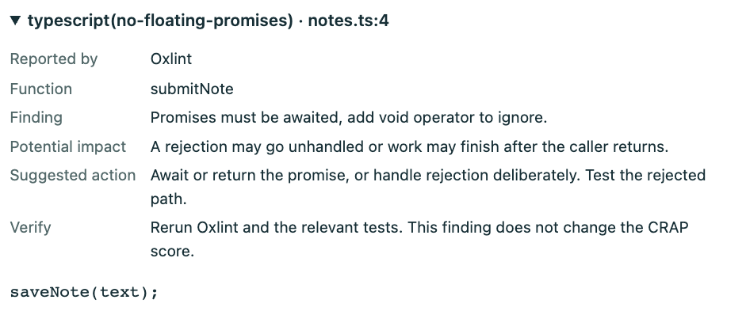

# Read a finding

The dashboard opens with score summaries. Expand a finding to see the file, affected line range, numbered excerpt when available, why the rule matched, its potential impact, how it affects the score, and how to repair and verify it.

## Inspect a function recommendation

In **Function explorer**, set **Show** to **Functions with code patterns**. Search for a function, expand its name, and open the rule underneath it. If the function has more than five findings, search for its name in **Code patterns** to see the rest.

Here, `submitNote` calls `saveNote(text)` without waiting for the result. If the caller needs to know whether the save succeeded, return the promise with `return saveNote(text)`. To verify the fix, make `saveNote` reject in a test and assert that the caller receives the error. Rerun the language check to confirm the finding clears. You can use this recommendation even when the function has no coverage score.

## Walk through a security finding

Suppose a query passes a template string containing a user-supplied ID directly to a database driver.

1. **Locate it.** Expand the interpolated SQL finding. Read the excerpt, then trace where the ID came from.
2. **Interpret the score.** The high-severity match carries a 25-point penalty. If the input is externally controlled, it could change the query structure.
3. **Repair the behavior.** Use the driver’s parameter-binding API. Test a value containing quotes and verify that the driver handles it as data.
4. **Compare.** Ask the security review skill to compare against its starting snapshot. A resolved finding retains its baseline location and excerpt.

## Return to the evidence

A chat review returns a **Detailed report** path to a standalone HTML file. A requested scorecard shows the summary as a PNG. In the dashboard, choose **Project settings → Recent checks → Open findings for this check** to inspect a recorded run. Older snapshots may have line references or aggregate counts only.

To generate an offline dashboard, run `npm run dashboard -- /absolute/path/to/checkout` from the server clone. Open `.crap-local/dashboard.html` in the target checkout. Exported reports can contain excerpts of the source being assessed.
