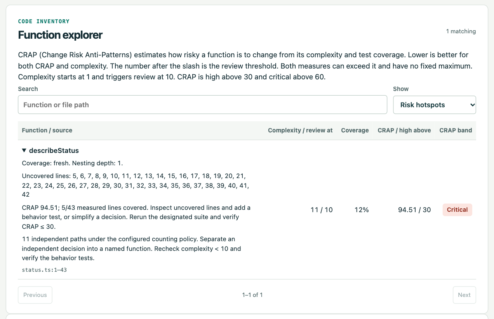

# Function CRAP

Change Risk Anti-Patterns (CRAP) combines the number of independent paths through a function with the fraction of its measured lines exercised by the designated test suite. **Lower is better.** A dashboard value of `94.51 / 30` means 94.51 against a review threshold of 30.

```text
CRAP = complexity² × (1 − coverage fraction)³ + complexity
```

Up to 30 is acceptable, above 30 through 60 is high, and above 60 is critical. Complexity of 10 or more and nesting depth of 4 or more also produce independent structural findings. When comparable coverage is missing, the function’s numeric CRAP is unavailable.

## A measured example

| Change to the HTTP-status fixture | Complexity | Covered lines | CRAP |
| --- | ---: | ---: | ---: |
| Test one supported status | 11 | 5/43 | 94.51 |
| Test every status and the fallback | 11 | 43/43 | 11.00 |
| Replace the branches with a lookup table | 2 | 3/3 | 2.00 |

First the tests exercised the decisions. Then the refactor reduced the number of decisions a maintainer must follow. Run `npm run prove` in the server clone to reproduce this example.



Start with [backlog triage](../skills/backlog-triage.md) to select a function or [development review](../skills/development-review.md) to measure a patch.
