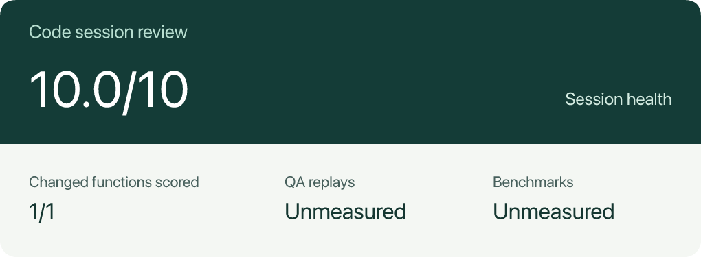

# Session health

[Development review](../skills/development-review.md) grades the final state of the functions affected by a patch, relative to its starting snapshot or Git revision. **Higher is better, up to 10.** Each surviving affected function has equal weight.

| Contribution per function | Points |
| --- | ---: |
| CRAP at or below 30 | 2.5 |
| Complexity below 10 | 2.5 |
| Nesting depth below 4 | 2.5 |
| Fraction of measured lines covered | 2.5 × coverage fraction |

For example, a function meeting the first three criteria with 80% coverage earns 9.5 points. The overall score averages contributions and truncates to one decimal. Removed functions appear separately. Mixed coverage can produce a provisional range. An incomplete scan, entirely unscored changes or a patch with no surviving changed functions can prevent a numeric grade.

Open **Score by changed function** to see each contribution. QA replay results and benchmark timings appear alongside the grade when recorded. Use their own results to assess behavior and performance.

The in-chat card uses Markdown. Ask for a PNG when you need an image to share.

